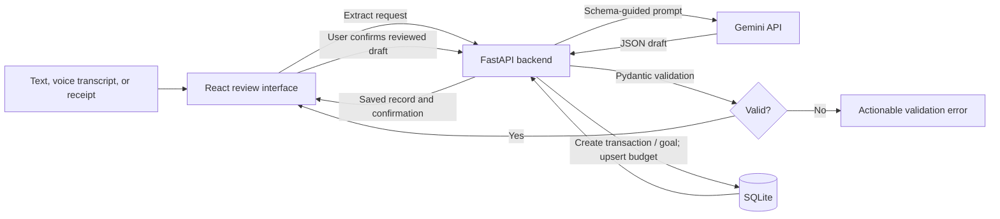

# FinPilot — Personal Finance Intelligence

**Course:** Generative AI Foundations (CSB312)
**Project choice:** Option 8 — FinPilot / personal finance and expense intelligence
**Objective:** Turn an everyday money note into a reviewed, categorized transaction, then save it to a personal finance ledger.
**Selected automation:** Convert a spoken expense or text note into a structured transaction and save it to a ledger. Receipt-to-draft extraction and savings-goal planning are included as supporting automations.

## Problem statement

People often record spending in informal notes or remember it later. Manually re-entering the amount, merchant, date, category and payment method makes a personal ledger harder to keep accurate. FinPilot accepts a natural-language note (or browser speech transcript), extracts a typed transaction, lets the user correct the draft, and writes the confirmed record to SQLite.

## Architecture and workflow



**Technology stack:** React and Vite frontend; Python and FastAPI backend; Pydantic request/schema validation; SQLite database; Google Gemini API for generative extraction, receipt reading and monthly analysis. If Gemini is not configured or fails during text extraction/goal planning, the app offers a rule-based local fallback and visibly identifies that mode. Receipt reading requires Gemini.

## Schema-guided extraction

Transaction draft fields:

| Field | Type | Validation |
|---|---|---|
| `amount` | number | Greater than zero, at most 100,000,000 |
| `currency` | string | `INR` |
| `merchant` | string or null | Optional |
| `category` | enum | Food, Transport, Shopping, Bills, Health, Education, Entertainment, Groceries, Travel, Income, Other |
| `transactionDate` | ISO date or null | Must parse as `YYYY-MM-DD` |
| `paymentMethod` | enum or null | Cash, UPI, Card, Bank Transfer, Other |
| `note` | string | Required, 1–300 characters |
| `transactionType` | enum | `expense` or `income` |

Users can create accounts with a unique username and password. Passwords are salted PBKDF2 hashes; each account receives an HMAC-signed 12-hour session, and transaction, goal, budget and insight queries are filtered by its user ID. The legacy local demo account retains existing records. Health is public so the frontend can display API availability. Sign-up and sign-in require a configured session secret of at least 32 characters.

Sample structured output for “I spent ₹450 on lunch at Green Bowl today using UPI”:

```json
{
  "amount": 450,
  "currency": "INR",
  "merchant": "Green Bowl",
  "category": "Food",
  "transactionDate": "2026-10-28",
  "paymentMethod": "UPI",
  "note": "I spent ₹450 on lunch at Green Bowl today using UPI",
  "transactionType": "expense"
}
```

The generated record is a draft first. The frontend displays editable fields and only calls the create endpoint after the user confirms. Missing or invalid required fields are rejected by Pydantic and returned as a readable API error. Failed requests are shown in the interface.

## Database and operations

SQLite tables store transactions, savings goals, category budgets and monthly insight records. `POST /api/transactions` inserts the reviewed transaction and returns the saved database row; `GET /api/transactions` and `GET /api/summary` read it back for frontend confirmation and dashboard totals. `POST /api/goals` creates a confirmed savings goal. `PUT /api/budgets` inserts or updates one category limit with SQLite `ON CONFLICT`, making budget changes repeatable. Monthly budget totals are calculated from saved expense transactions for the current month.

## Interfaces and test cases

The dashboard includes balance/income/expense totals, category breakdown, natural-language and speech entry, receipt upload, editable transaction review, savings goal planning, category budgets, monthly insights, and the saved transaction ledger. Use the project run instructions in `README.md` to capture submission screenshots of the interface, a successful saved transaction, and an invalid-input error with your own local records and API key.

Automated backend coverage is in `backend/tests/test_api.py`:

| Scenario | Expected result |
|---|---|
| Health and root endpoints | API reports a connected SQLite database |
| Sign-in and route protection | Valid credentials return a session; wrong credentials and unauthenticated ledger requests are rejected |
| Account sign-up and isolation | Creates a password hash, saves a record, and keeps it out of another account's ledger |
| Extract a valid expense | Returns a typed draft and does not write it yet |
| Confirm a valid expense | Returns HTTP 201 and the record appears in the ledger |
| Plan and save a savings goal | Returns a plan, persists the confirmed goal |
| Save a Food budget | Returns the limit and includes current-month saved spend |
| Analyze a month | Returns structured insights for its dated transaction |
| Submit an invalid budget category | Rejects the request with HTTP 400 |

The frontend production build and Python syntax compilation passed during this repair. The Python suite could not complete in this workspace: the bundled Starlette TestClient requires `httpx2`, which is now listed in `backend/requirements.txt`, but network access prevented installing it here. Install the requirements and run `python -m pytest -q` from `backend/` to record the test result for submission.

## Safeguards, limitations and future work

- Users review drafts before financial records or goals are saved; monthly recommendations never modify budgets automatically.
- The project is an educational tracker and does not connect to banks or provide financial advice.
- Voice recognition depends on browser support and microphone permission. Gemini receipt extraction requires a valid key and supported model.
- Local fallback extraction is rule-based rather than generative. SQLite is intended for a local or single-instance demonstration and needs persistent storage when hosted.
- Future work: user authentication and per-user data isolation, recurring transactions, edit/delete history, broader locale/currency support, server-side rate limits, and a hosted database.

## Deployment submission

**Frontend URL:** Not deployed from this workspace. The [Render Blueprint](render.yaml) defines the API, static frontend and persistent SQLite disk. Deployment requires the project to be pushed to a Git provider and connected to a Render account; enter private login credentials and optional Gemini API key during setup. Add the resulting public frontend URL here before submission.
